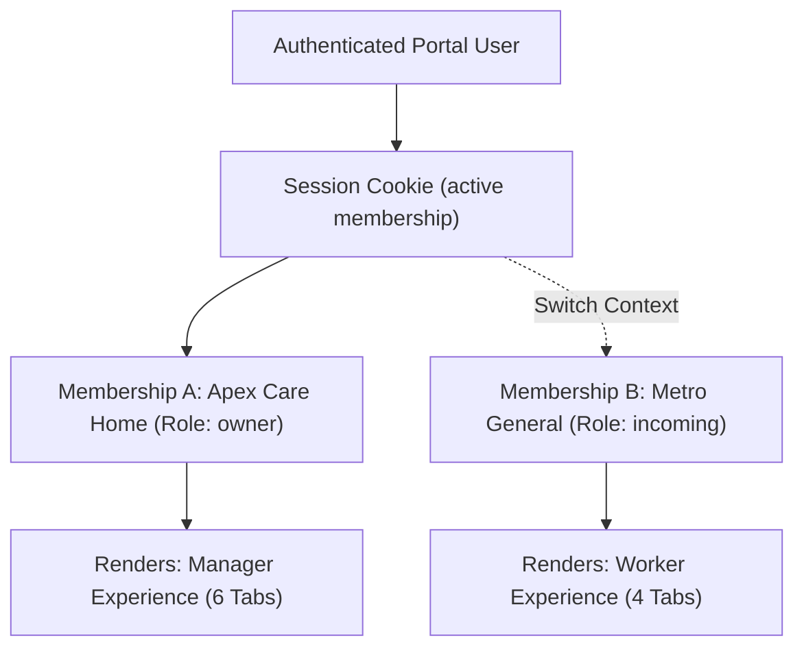

# ShiftRelay UI/UX Restructuring — Discovery & Architecture Proposal

## 1. Executive Summary

This proposal outlines the restructuring of ShiftRelay's user interface and experience. The objective is to replace the prototype/monolithic layout with two purpose-built, distinct user experiences sharing a unified, accessible design system:
1. **Frontline Worker Experience**: Fast, low-friction, mobile-first workflow centered on daily operations (clocking, shift tasks, handover execution, and personal schedule).
2. **Manager & Owner Experience**: Comprehensive desktop/tablet-optimized operations desk focused on oversight, roster scheduling, team directory, handover auditing, and membership/leave approvals.

All proposals strictly adhere to the security, multi-tenant isolation, idempotency, and pilot endpoint restrictions established in Batches 1–4. Dead buttons, mock social feeds, simulated job boards, and hardcoded demo metrics are systematically removed or replaced with real backend-driven capabilities.

---

## 2. Role Capability Mapping Matrix

In ShiftRelay's PostgreSQL database and backend authorization layers, a user's permissions derive from their active `memberships` record. The canonical roles and their allowed backend capabilities are:

| Role Category | Canonical DB Role | Core Responsibilities | Backend API Permissions | UI Presentation Tier |
|---|---|---|---|---|
| **Frontline Worker** | `outgoing` | Concludes outgoing shift; authors handover brief. | `POST /api/handovers` (create), `POST /api/handovers/:id/tasks/:taskId/toggle`, `POST /api/time-entries/clock-in`, `POST /api/time-entries/clock-out`, `GET /api/time-entries`, `GET /api/calendar`, `POST /api/leave-requests`, `GET /api/leave-requests`, `GET /api/directory`, `GET /api/wellbeing-quote`, `PUT /api/profile` | Worker Navigation (Today, Schedule, Handovers, Me) |
| **Frontline Worker** | `incoming` | Takes over shift; inspects and acknowledges incoming handover. | `POST /api/handovers/:id/acknowledge`, `POST /api/handovers/:id/tasks/:taskId/toggle`, `POST /api/time-entries/clock-in`, `POST /api/time-entries/clock-out`, `GET /api/time-entries`, `GET /api/calendar`, `POST /api/leave-requests`, `GET /api/leave-requests`, `GET /api/directory`, `GET /api/wellbeing-quote`, `PUT /api/profile` | Worker Navigation (Today, Schedule, Handovers, Me) |
| **Frontline Worker** | `worker` | General operational worker with standard checklist and time-tracking needs. | Clock-in/out, view calendar, toggle tasks, submit leave requests, view profile, directory, and wellbeing quotes. | Worker Navigation (Today, Schedule, Handovers, Me) |
| **Operational Manager** | `supervisor` | Shift supervisor responsible for quality control, relaying handovers, and approving access. | All worker capabilities plus: `POST /api/handovers/:id/relay` (approve & relay), `GET /api/memberships/pending`, `POST /api/memberships/:id/review`, `POST /api/calendar/shifts` (assign shifts). *(Cannot review leave requests or view audit logs).* | Manager Navigation (Overview, Schedule, Team, Handovers, Approvals) |
| **Executive / Admin** | `owner` | Organization creator and company administrator. | All supervisor and worker capabilities plus: `POST /api/leave-requests/review`, `GET /api/audit-events`, `GET/PUT /api/organisation/settings`, `GET/POST /api/workflow-templates`, `POST /api/account-deletion-requests`. | Manager Navigation with Settings (Overview, Schedule, Team, Handovers, Approvals, Settings) |

> [!IMPORTANT]
> Hiding an interface element does not constitute authorization. Server-side role checks and tenant checks (`server.mjs`) remain the source of truth. If a worker attempts to craft a request to `/api/memberships/pending`, the backend rejects with HTTP 403.

---

## 3. Multi-Role & Multi-Company Workspace Switcher

### Architectural Model
A single `portal_user` may possess active memberships across multiple organizations or facilities (e.g., *Owner* at "Apex Care Home", *Incoming Worker* at "Metro General Hospital"). 



### UX Design
1. **Header Context Pill**: Positioned prominently in the top app header:
   ```html
   <button class="sr-org-pill" id="btn-org-switcher" aria-haspopup="dialog" aria-expanded="false">
     <span class="sr-org-dot"></span>
     <span class="sr-org-name">Apex Care Home</span>
     <span class="sr-org-role">Owner</span>
     <svg class="sr-icon-chevron" ...></svg>
   </button>
   ```
2. **Context Switch Modal (`#sr-org-modal`)**:
   - Queries `GET /api/user/memberships`.
   - Lists verified organizations, member role, and facility status.
   - Highlights the currently active organization.
   - Clicking an alternative company invokes `POST /api/user/active-membership { membershipId }`.
   - Upon HTTP 200, the client resets view state, immediately terminates the old SSE connection, establishes the new SSE connection scoped to the new company ID, and switches the navigation bar to the appropriate tier (Worker vs. Manager).

---

## 4. Navigation Architecture

ShiftRelay uses one unified design system with two role-tailored view shells:

### A. Frontline Worker Navigation
- **Mobile**: Persistent 4-item bottom dock (64px height + safe-area insets).
- **Desktop/Tablet**: Left-hand compact sidebar with icons and labels.
- **Header**: Org switcher (left), Sync status pill (center), Notification bell & Profile avatar (right).

| Tab | Screen / View | Description & Capabilities | Backend Endpoints |
|---|---|---|---|
| **Today** | `worker-today` | Operational home: Active clock-in card with live elapsed timer; pinned current shift handover; priority task checklist (with interactive checkboxes); daily wellbeing quote. | `GET /api/time-entries`, `POST /api/time-entries/clock-in`, `POST /api/time-entries/clock-out`, `GET /api/handovers`, `POST /api/handovers/:id/tasks/:taskId/toggle`, `GET /api/wellbeing-quote` |
| **Schedule** | `worker-schedule` | Personal shift calendar: Roster view of assigned shifts; upcoming shift details; Leave request submission form and status list. | `GET /api/calendar`, `GET /api/leave-requests`, `POST /api/leave-requests` |
| **Handovers** | `worker-handovers` | Handover operational hub: For `outgoing`: Create structured handover brief with AI transcription/analysis. For `incoming`: Await & acknowledge relayed handover with digital signature timestamp. List of recent handovers. | `GET /api/handovers`, `POST /api/handovers`, `POST /api/handovers/:id/acknowledge`, `POST /api/analyze`, `POST /api/transcribe` |
| **Me** | `worker-me` | Profile & settings: Account information, email, role/position; active facility info; dark mode toggle; change password; sign out with offline-sync check. | `GET /api/auth/session`, `PUT /api/profile`, `PUT /api/auth/password`, `POST /api/auth/sign-out` |

### B. Manager / Owner Navigation
- **Layout**: Adaptive responsive sidebar on desktop/tablet, collapsing to top/bottom navigation on mobile.
- **Header**: Org switcher, Notification bell (with pending badge count), Supervisor Profile.

| Tab | Role Scope | Screen / View | Description & Capabilities | Backend Endpoints |
|---|---|---|---|---|
| **Overview** | Supervisor / Owner | `mgr-overview` | Real-time operations center: Live shift metrics (active clock-ins count, pending handovers requiring review, pending access requests); unacknowledged shift alerts; active incident feed. | `GET /api/attendance/today`, `GET /api/handovers`, `GET /api/memberships/pending`, `GET /api/events` |
| **Schedule** | Supervisor / Owner | `mgr-schedule` | Facility schedule management: Roster calendar across all team members; shift creation modal (assign date, time, worker, role); schedule overview. | `GET /api/calendar`, `POST /api/calendar/shifts` |
| **Team** | Supervisor / Owner | `mgr-team` | Organization directory: List of all active workers and managers; role badges; contact details; department categorization. | `GET /api/directory`, `GET /api/organisation/profile` |
| **Handovers** | Supervisor / Owner | `mgr-handovers` | Shift handover quality & audit log: Supervisor review queue (`status: awaiting_review`) with "Approve & Relay" action; full chronological archive of acknowledged handovers; printable compliance sheet. | `GET /api/handovers`, `POST /api/handovers/:id/relay`, `POST /api/handovers` |
| **Approvals** | Supervisor / Owner | `mgr-approvals` | Gatekeeping queue: Worker access request review (Approve with worker role assignment or Reject); for **Owner only**: Leave request review (Approve/Reject employee leave). | `GET /api/memberships/pending`, `POST /api/memberships/:id/review`, `GET /api/leave-requests`, `POST /api/leave-requests/review` |
| **Settings** | Owner Only | `mgr-settings` | Organization configuration: Facility legal & trading name, industry, timezone; workflow templates builder; compliance audit event logs. | `GET /api/organisation/settings`, `PUT /api/organisation/settings`, `GET /api/workflow-templates`, `POST /api/workflow-templates`, `GET /api/audit-events` |

---

## 5. Screen & Control Inventory: Audit of Existing Elements

| Screen / Component | Existing Control / Element | Allowed Roles | Backend Dependency | Verdict | Rationale & Remediation |
|---|---|---|---|---|---|
| **Landing / Auth** | Splash screen (`#sr-splash`) | Public | None | **Keep & Polish** | Auto-authenticates valid sessions or transitions to entry sheet. |
| **Landing / Auth** | Entry Screen (`#sr-entry`) | Public | None | **Keep** | Clean minimal onboarding. |
| **Landing / Auth** | Bottom sheet login/register (`#sr-login-modal`) | Public | `POST /api/auth/sign-in`, `POST /api/auth/register`, `POST /api/organisation-memberships` | **Keep** | Supports direct email/password login and organization registration. Demo login tabs only visible when `config.demoMode = true`. |
| **Header** | Notification Bell (`#btn-notifications`) | All authenticated | `GET /api/notifications`, `POST /api/notifications/read` | **Keep & Redesign** | Relocate to app header for all users. Shows badge count; clicking opens notification dropdown panel with "Mark all read". |
| **Header** | Workplace switcher | All authenticated | `GET /api/user/memberships`, `POST /api/user/active-membership` | **Redesign** | Make a prominent header pill with active organization and role display. |
| **Worker Today** | Clock-in / Clock-out card | All workers | `POST /api/time-entries/clock-in`, `POST /api/time-entries/clock-out`, `GET /api/time-entries` | **Keep & Redesign** | Real-time elapsed counter, single primary button that toggles state atomically. |
| **Worker Today** | Handover task list | Worker, Supervisor | `POST /api/handovers/:id/tasks/:taskId/toggle` | **Keep & Polish** | Interactive task checklist for the shift. Checkbox sends atomic toggle to backend. |
| **Worker Today** | Wellbeing Quote Card | All workers | `GET /api/wellbeing-quote`, `POST /api/wellbeing-quote/react` | **Keep** | Genuine backend quote and reactions. |
| **Handover Card** | "Swap" Button (`data-action="swap-request"`) | Any | `POST /api/feed/posts` / mock | **REMOVE** | **Dead / Misleading control**. Shift swaps are disabled server-side (`/api/shift-swaps` 501). Button was posting fake requests into social feed. Remove completely from handover cards. |
| **Handover Card** | "Approve & relay" Button | `supervisor`, `owner` | `POST /api/handovers/:id/relay` | **Keep & Relocate** | Relocate strictly to Manager Review Queue / Manager Handovers view. Workers never see this button. |
| **Handover Card** | "Acknowledge" Button | `incoming`, `owner` | `POST /api/handovers/:id/acknowledge` | **Keep & Redesign** | Visible on worker incoming handover card with clear confirmation dialog. |
| **Handover Create** | Audio recording / Transcribe | `outgoing`, `supervisor`, `owner` | `POST /api/transcribe`, `POST /api/analyze` | **Redesign** | Connect real MediaRecorder API directly to `/api/transcribe` instead of mock pulsing animations. |
| **Navigation** | Social Lounge Tab (`data-go="lounge"`) | All | `/api/feed/*` | **REMOVE** | **Disabled capability**. Social feed is disabled server-side with HTTP 501. Remove tab, feed posts, story viewer, and composer completely from navigation. |
| **Navigation** | Discover Tab (`data-go="discover"`) | All | `/api/discover/*`, `/api/verified-badge-request` | **REMOVE** | **Disabled capability**. Worker discovery, job board, and badges are disabled with HTTP 501. Remove tab and simulated job postings completely. |
| **Worker Passport** | Peer Endorsements & Verified Badge | Worker | `/api/worker-profile/:id/endorse`, `/api/verified-badge-request` | **REMOVE** | Endpoints disabled or mock; replace with clean "Me" account details screen. |
| **Manager Approvals** | Membership access approval | `supervisor`, `owner` | `GET /api/memberships/pending`, `POST /api/memberships/:id/review` | **Keep & Redesign** | Standalone Approvals tab. Allows manager to approve worker with canonical worker role (`incoming`, `outgoing`, `worker`) or reject. |
| **Manager Approvals** | Leave request approval | `owner` | `GET /api/leave-requests`, `POST /api/leave-requests/review` | **Keep & Redesign** | Owner review section inside Approvals tab. |
| **Manager Settings** | Workflow template manager | `owner` | `GET /api/workflow-templates`, `POST /api/workflow-templates` | **Keep & Redesign** | Configuration interface for owners to define standard shift workflow steps. |
| **Manager Settings** | Audit event history | `owner` | `GET /api/audit-events` | **Keep & Redesign** | Chronological security and operational event log table with actor, timestamp, and details. |

---

## 6. Shared Design System & Tokens

### Color Palette (WCAG 2.1 AA/AAA Compliant)
```css
:root {
  /* Brand Primary: Deep Teal */
  --sr-brand-primary: #0d524d;
  --sr-brand-primary-hover: #0a3d39;
  --sr-brand-accent: #10b981;
  --sr-brand-accent-subtle: #ecfdf5;

  /* Surfaces & Backgrounds */
  --sr-bg-canvas: #f8fafc;
  --sr-bg-surface: #ffffff;
  --sr-bg-elevated: #ffffff;
  --sr-bg-subtle: #f1f5f9;

  /* Text & Typography */
  --sr-text-main: #0f172a;       /* Slate 900 */
  --sr-text-secondary: #334155;  /* Slate 700 */
  --sr-text-muted: #64748b;      /* Slate 500 */
  --sr-text-inverse: #ffffff;

  /* Borders & Dividers */
  --sr-border-subtle: #e2e8f0;   /* Slate 200 */
  --sr-border-medium: #cbd5e1;   /* Slate 300 */
  --sr-border-strong: #94a3b8;   /* Slate 400 */

  /* Semantic Statuses */
  --sr-status-green-bg: #ecfdf5;
  --sr-status-green-text: #065f46;
  --sr-status-green-border: #a7f3d0;

  --sr-status-yellow-bg: #fffbeb;
  --sr-status-yellow-text: #92400e;
  --sr-status-yellow-border: #fde68a;

  --sr-status-red-bg: #fef2f2;
  --sr-status-red-text: #991b1b;
  --sr-status-red-border: #fecaca;
}

[data-theme="dark"] {
  --sr-bg-canvas: #0b0f17;
  --sr-bg-surface: #131b26;
  --sr-bg-elevated: #1a2433;
  --sr-bg-subtle: #1e293b;

  --sr-text-main: #f8fafc;
  --sr-text-secondary: #cbd5e1;
  --sr-text-muted: #94a3b8;

  --sr-border-subtle: #1e293b;
  --sr-border-medium: #334155;
  --sr-border-strong: #475569;
}
```

### Typography
- **Font Stack**: `'Inter', system-ui, -apple-system, sans-serif`
- **Monospace Stack**: `'JetBrains Mono', 'SF Mono', Consolas, monospace`
- **Type Scale**:
  - `Display`: 26px / 32px line-height, Bold 800, `-0.03em` tracking
  - `H1`: 20px / 26px, Bold 700, `-0.02em` tracking
  - `H2`: 16px / 22px, Semi-Bold 600, `-0.01em` tracking
  - `Body`: 14px / 20px, Regular 400 / Medium 500
  - `Caption / Meta`: 12px / 16px, Medium 500
  - `Micro / Badge`: 10.5px / 14px, Bold 700, `0.04em` tracking

### Accessible Touch & Interaction Targets
- Minimum touch target: **44px × 44px** on all clickable buttons, dock tabs, checkboxes, and select menus.
- Clear `:focus-visible` outline: `2px solid var(--sr-brand-primary)` with `2px offset`.

---

## 7. Responsive Shell Architecture

```
Mobile View (< 768px):
+------------------------------------------+
| Header: [Apex Care Home v]  [Sync] (Bell)(Me)|
+------------------------------------------+
|                                          |
|            Main Scroll View              |
|          (Today / Schedule / ...)        |
|                                          |
+------------------------------------------+
| Dock: [Today] [Schedule] [Handovers] [Me]|
+------------------------------------------+

Desktop / Tablet View (>= 768px):
+------------+-------------------------------------------------------+
| ShiftRelay | Header: [Apex Care Home v] [Role Pill]  (Bell) (User) |
|            +-------------------------------------------------------+
| [Overview] |                                                       |
| [Schedule] |                                                       |
| [Team]     |              Main Operations Desk Content             |
| [Handovers]|                                                       |
| [Approvals]|                                                       |
| [Settings] |                                                       |
+------------+-------------------------------------------------------+
```

---

## 8. Original SVG Logo Directions

Below are three distinct, clean SVG logo concepts designed for the ShiftRelay header, app icon, and favicon:

### Direction 1: "The Relay Loop" (Geometric Baton Passing)
A continuous Mobius-style ribbon with two interlocking segments in deep teal and mint accent, symbolizing the unbroken cycle between outgoing and incoming workers.

```xml
<svg xmlns="http://www.w3.org/2000/svg" viewBox="0 0 48 48" width="48" height="48" fill="none">
  <defs>
    <linearGradient id="sr-grad-loop-1" x1="4" y1="8" x2="36" y2="40" gradientUnits="userSpaceOnUse">
      <stop stop-color="#0d524d"/>
      <stop offset="1" stop-color="#10b981"/>
    </linearGradient>
  </defs>
  <!-- Outer relay trajectory -->
  <path d="M12 28 C12 36, 24 38, 30 32 L38 24 C44 18, 40 10, 32 10 C24 10, 20 18, 16 22 Z" 
        stroke="url(#sr-grad-loop-1)" stroke-width="4.5" stroke-linecap="round" stroke-linejoin="round"/>
  <!-- Return loop -->
  <path d="M36 20 C36 12, 24 10, 18 16 L10 24 C4 30, 8 38, 16 38 C24 38, 28 30, 32 26 Z" 
        stroke="#0d524d" stroke-width="4.5" stroke-linecap="round" stroke-linejoin="round" opacity="0.35"/>
  <!-- Sync pulse node -->
  <circle cx="38" cy="24" r="3.5" fill="#10b981"/>
</svg>
```

### Direction 2: "The 24h Shift Dial & Check"
A circular 24-hour shift dial with a clock hand transitioning smoothly into an accountability checkmark.

```xml
<svg xmlns="http://www.w3.org/2000/svg" viewBox="0 0 48 48" width="48" height="48" fill="none">
  <!-- Circular shift ring -->
  <circle cx="24" cy="24" r="18" stroke="#cbd5e1" stroke-width="3.5" stroke-dasharray="2 4"/>
  <!-- Active handover sector -->
  <path d="M24 6 A18 18 0 0 1 42 24" stroke="#0d524d" stroke-width="4.5" stroke-linecap="round"/>
  <!-- Dynamic handover transition arrow / checkmark -->
  <path d="M16 24 L22 30 L34 16" stroke="#10b981" stroke-width="4.5" stroke-linecap="round" stroke-linejoin="round"/>
</svg>
```

### Direction 3: "The Frontline Nexus"
Two interlocking hexagonal links symbolizing shifts locking together securely without operational gaps.

```xml
<svg xmlns="http://www.w3.org/2000/svg" viewBox="0 0 48 48" width="48" height="48" fill="none">
  <!-- Outgoing shift hex -->
  <polygon points="18,6 30,6 36,16 30,26 18,26 12,16" 
           stroke="#0d524d" stroke-width="4" stroke-linejoin="round"/>
  <!-- Incoming shift hex interlocking -->
  <polygon points="18,22 30,22 36,32 30,42 18,42 12,32" 
           stroke="#10b981" stroke-width="4" stroke-linejoin="round"/>
  <!-- Center overlap lock pin -->
  <circle cx="24" cy="24" r="2.5" fill="#0d524d"/>
</svg>
```

---

## 9. Presentation-Only Workflow Labels

To serve healthcare, retail, manufacturing, or logistics without hardcoding domain-specific strings into core database schemas (`work_items`, `memberships`), ShiftRelay will employ a client-side presentation mapping dictionary:

```javascript
const WORKFLOW_DICTIONARY = {
  healthcare: {
    workplace: 'Hospital / Facility',
    unit: 'Ward / Department',
    worker: 'Staff Nurse / Clinician',
    supervisor: 'Charge Nurse / Sister',
    handover: 'Clinical Shift Turnover',
    priorityTask: 'Critical Patient Actions'
  },
  logistics: {
    workplace: 'Fulfillment Hub',
    unit: 'Zone / Berth',
    worker: 'Forklift Operator / Handler',
    supervisor: 'Warehouse Shift Lead',
    handover: 'Berth & Freight Turnover',
    priorityTask: 'Pre-Shift Safety Checks'
  },
  standard: {
    workplace: 'Workplace',
    unit: 'Department',
    worker: 'Frontline Worker',
    supervisor: 'Shift Supervisor',
    handover: 'Shift Handover',
    priorityTask: 'Shift Tasks'
  }
};
```
The active dictionary defaults to `standard` (or the organization's `industry` field) purely for visual labels, preserving schema stability.

---

## 10. Major Capability Gaps Identified

1. **Shift Swaps & Claiming are Disabled (501)**: The UI previously displayed a "Swap" button on handover cards and simulated open shift claiming. Until a hardened peer-swap state machine is migrated, all UI references must be cleanly removed to avoid user confusion.
2. **Social Feed & Discover are Disabled (501)**: The prototype had `renderShiftLounge` and `renderDiscover` generating mock cards and trying to POST to `/api/feed/posts`. They must be removed from primary navigation.
3. **Supervisor Leave Approvals**: Currently `POST /api/leave-requests/review` is restricted strictly to `user.role === 'owner'`. Supervisors cannot approve leave requests unless backend policy expands. The Approvals tab must show leave requests only to Owners.
4. **Offline Queue Sync Confirmation**: "Sync Now & Sign Out" was fixed in Batch 3 to abort on sync failure; the new UI must integrate the network heartbeat pill cleanly into the top header.

---

## 11. Proposed Implementation Sequence

1. **Phase 1 — Shell & Navigation Foundation**:
   - Update `index.html` structure: Remove obsolete Lounge, Discover, and Passport views.
   - Introduce responsive app header with Org Switcher, Sync status pill, Notification bell, and Profile avatar.
   - Implement role-differentiated navigation (Worker 4-tab dock vs. Manager 6-tab sidebar).
2. **Phase 2 — Multi-Company Context Switcher**:
   - Implement the `#sr-org-modal` component connected to `/api/user/memberships` and `/api/user/active-membership`.
   - Ensure dynamic re-render and SSE re-scoping on context switch.
3. **Phase 3 — Worker Experience Views**:
   - Restructure **Today** (Live Clock-in/out, Pinned Handover, Task Checklist, Wellbeing Quote).
   - Restructure **Schedule** (Calendar shifts, Leave request submission & status list).
   - Restructure **Handovers** (Create for outgoing with speech-to-text; Acknowledge for incoming).
   - Restructure **Me** (Account info, dark mode, password update, safe logout).
4. **Phase 4 — Manager & Owner Experience Views**:
   - Restructure **Overview** (Live metrics, shift status).
   - Restructure **Schedule** (Roster view, shift assignment modal).
   - Restructure **Team** (Directory table).
   - Restructure **Handovers** (Review queue with relay action, acknowledged archive).
   - Restructure **Approvals** (Membership access review for Supervisors/Owners; Leave review for Owners).
   - Restructure **Settings** (Owner only: Org profile, workflow templates, audit logs).
5. **Phase 5 — Polish & Verification**:
   - Implement one chosen SVG logo direction.
   - Run full regression suites (Batch 2A, 2B, 2C, 3, 4) to ensure zero broken backend contracts.
